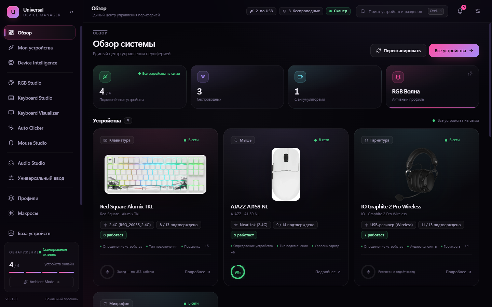
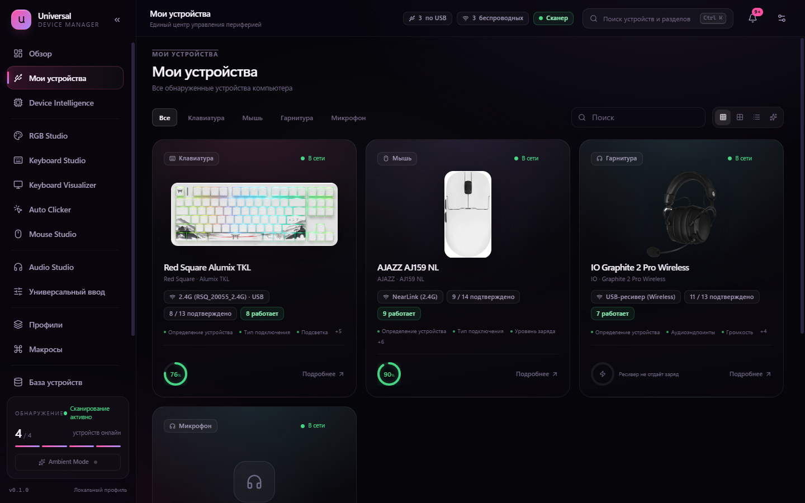
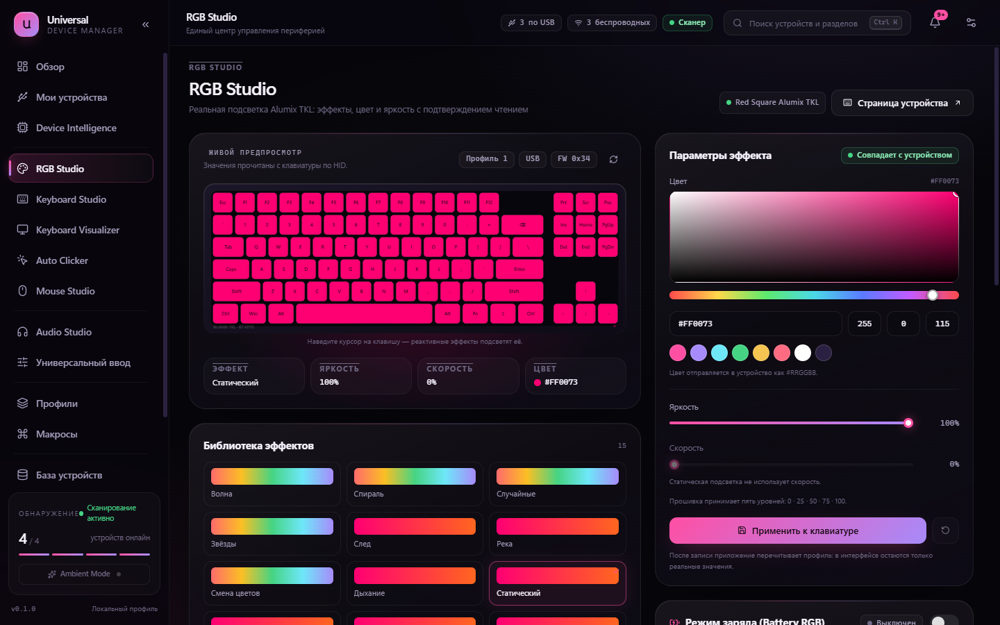
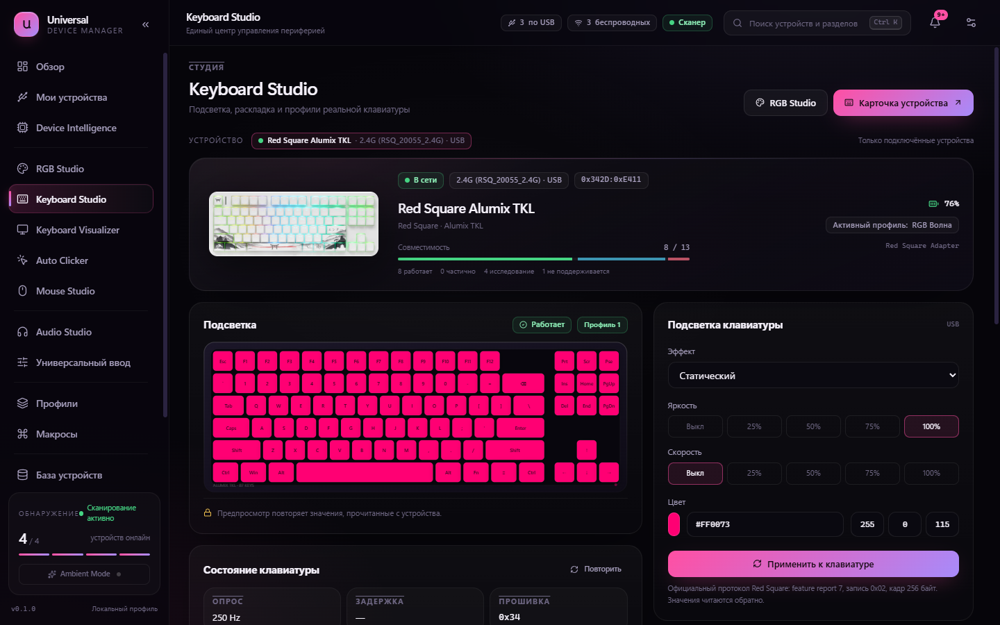
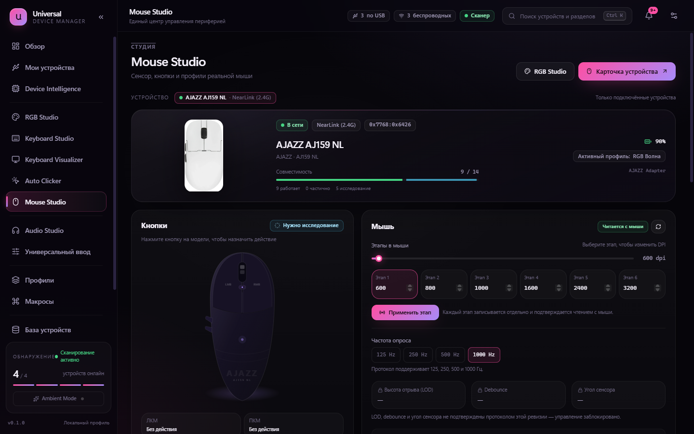
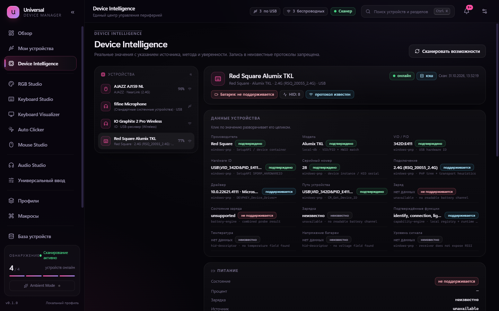
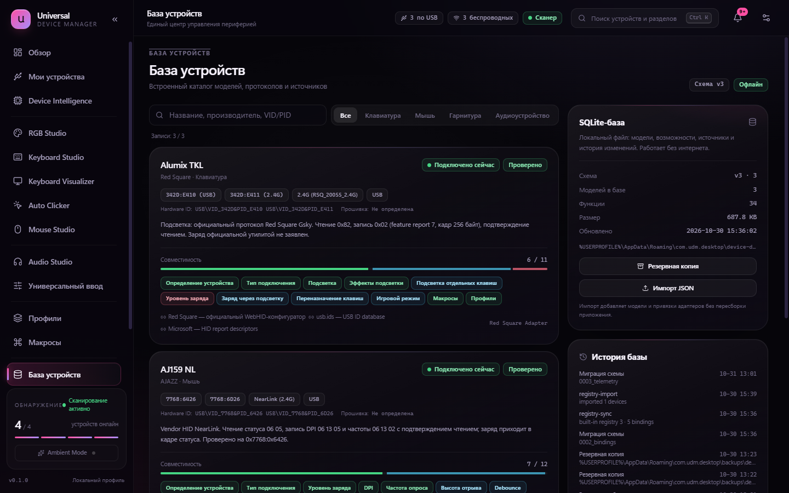
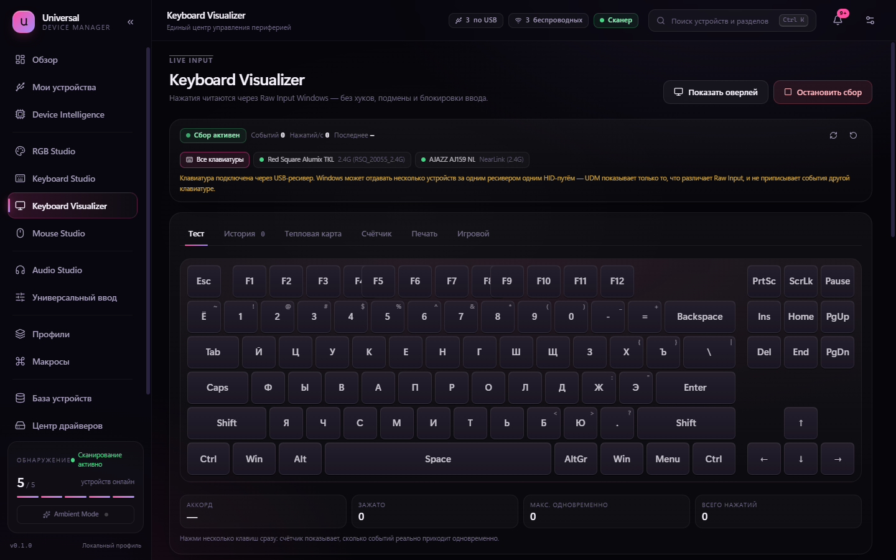
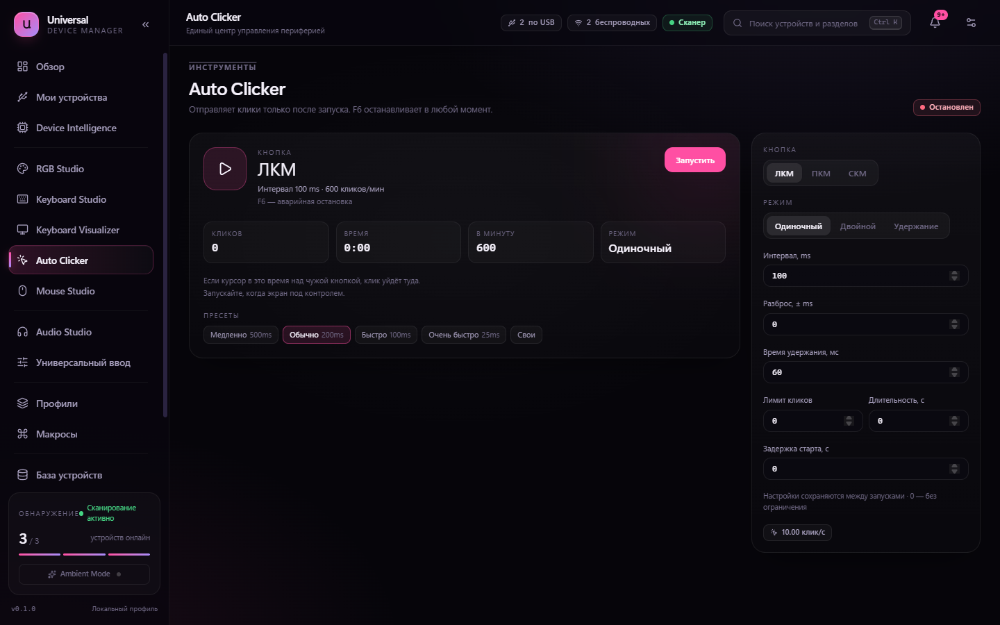
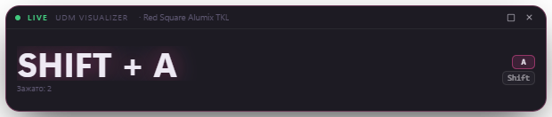

# Universal Device Manager

[](https://github.com/Smirty8181/universal-device-manager/actions/workflows/ci.yml)
[](https://github.com/Smirty8181/universal-device-manager/releases/latest)
[](INSTALLATION.md)
[](LICENSE)

UDM — менеджер периферии для Windows: клавиатуры, мыши, гарнитуры, микрофоны и другие HID-устройства в одном приложении.

Находит устройства через PnP, HID и Bluetooth, показывает заряд только при наличии реального источника, управляет подсветкой и DPI на проверенных протоколах, даёт живую визуализацию клавиатуры, макросы, профили, автокликер и диагностику.

<details>
<summary>Read this in English</summary>

UDM is a Windows peripheral manager built with Tauri 2, Vue 3 and Rust. It enumerates keyboards, mice, headsets and other HID devices through SetupAPI, HID and Bluetooth, merges the cable / 2.4 GHz dongle / Bluetooth faces of one device, and reads battery level only when a real source exists (vendor protocol, BLE Battery Service or HID Battery Strength). RGB, DPI and polling rate are exposed only for protocols verified on real hardware; everything else stays read-only and is labelled as such. The app also ships a live keyboard visualizer, an overlay window, macros, profiles, per-app volume, a driver center that checks signatures, an SQLite device database and an auto clicker with an F6 kill switch. No telemetry, no account, no admin rights for normal use.

</details>



## Возможности

**Устройства и телеметрия**

- обнаружение через Windows PnP/SetupAPI, HID и Bluetooth; VID, PID, Hardware ID, ревизия, интерфейсы, транспорт;
- объединение USB-кабеля, 2.4 ГГц ресивера и Bluetooth в одно устройство без ложных «USB» подписей;
- заряд из vendor-протоколов, BLE Battery Service (0x180F/0x2A19) и HID Battery Strength; источник и достоверность видны в интерфейсе;
- история заряда, ресиверы, read-only исследование неизвестных протоколов и экспорт диагностики.

**Студии**

- RGB Studio: реальные эффекты, цвет, яркость, скорость и зоны для проверенных устройств; Battery RGB с диапазонами и возвратом профиля;
- Keyboard Studio: подсветка, ремап клавиш, макросы;
- Mouse Studio: DPI-этапы и polling rate AJAZZ с подтверждением чтением; системные параметры мыши;
- Audio Studio: громкость Windows и отдельных приложений, mute, микрофон, пресеты Equalizer APO.

**Инструменты**

- Live Keyboard Visualizer: Raw Input, раскладки RU/EN, история, счётчики, heatmap, gaming-режим;
- прозрачный overlay для игр, который не забирает фокус;
- Auto Clicker: ЛКМ/ПКМ/СКМ, single/double/hold, интервал, разброс, лимит, длительность, задержка, пресеты и остановка по F6;
- профили и автоматическое переключение по процессу, трей с зарядом и быстрыми действиями, база устройств SQLite, центр драйверов с проверкой подписи.

## Скриншоты

| Список устройств | RGB Studio |
|---|---|
|  |  |
| Keyboard Studio | Mouse Studio |
|  |  |
| Device Intelligence | База устройств |
|  |  |
| Визуализатор | Auto Clicker |
|  |  |

Overlay для игр — прозрачная полоса поверх окна, которая не забирает фокус:



## Скачать

Свежие сборки лежат в [Releases](https://github.com/Smirty8181/universal-device-manager/releases/latest): установщик `Universal Device Manager_0.1.0_x64-setup.exe`, портативный архив `UDM-0.1.0-win-x64.zip` и `SHA256SUMS.txt` к ним.

## Требования

- Windows 10/11 x64;
- WebView2 Runtime (в Windows 11 уже установлен);
- для сборки: Node.js 20+, Rust stable, компонент WebView2 build tools.

## Установка

Скачайте установщик из раздела Releases и запустите. Установка per-user, права администратора не требуются; они понадобятся только при установке драйверов по кнопке.

Portable-версия распространяется архивом: распакуйте и запустите `Universal Device Manager.exe`. Подробности — в [INSTALLATION.md](INSTALLATION.md).

## Сборка

```bash
npm install
npm run tauri build
```

Установщик появится в `src-tauri/target/release/bundle/nsis/`. Полные требования и варианты toolchain — в [BUILDING.md](BUILDING.md).

## Разработка

```bash
npm run dev          # интерфейс в браузере с демо-данными
npm run tauri dev    # приложение с реальным железом
npm run lint
npm test
```

Rust:

```bash
cargo fmt --manifest-path src-tauri/Cargo.toml -- --check
cargo clippy --manifest-path src-tauri/Cargo.toml --all-targets
bash scripts/test-rust.sh
```

## Совместимость

Системные функции (обнаружение, заряд по стандартным каналам, громкость, ремап, макросы, автокликер, визуализатор) не зависят от бренда. Фирменные RGB и DPI включаются только для протоколов, проверенных на реальном устройстве: Red Square Alumix TKL и AJAZZ AJ159 NL. Для остальных моделей панели отключены с объяснением.

Список проверенных устройств и правила добавления новых — в [SUPPORTED_DEVICES.md](SUPPORTED_DEVICES.md).

## Ограничения

- UDM не обновляет прошивки без официального способа восстановления и не устанавливает неподписанные драйверы.
- Проценты заряда не вычисляются и не подставляются: если источник недоступен, интерфейс так и сообщает.
- Синтетический ввод (скрипты, удалённый доступ) может не доходить до Raw Input; визуализатор рассчитан на физические устройства.
- Приложение только для Windows: используются SetupAPI, Raw Input, WASAPI и SendInput.

## Приватность и безопасность

Визуализатор не сохраняет введённый текст, не ведёт скрытый журнал и не отправляет нажатия в сеть. Auto Clicker запускается только пользователем и не обходит защиты игр. Установка драйверов требует подтверждения и проверки подписи. Подробнее — в [SECURITY.md](SECURITY.md).

## Документация

[Архитектура](ARCHITECTURE.md) · [Сборка](BUILDING.md) · [Установка](INSTALLATION.md) · [Поддерживаемые устройства](SUPPORTED_DEVICES.md) · [Решение проблем](TROUBLESHOOTING.md) · [Аудит](PROJECT_AUDIT.md) · [Изменения](CHANGELOG.md) · [Участие](CONTRIBUTING.md)

## Лицензия

Код распространяется по MIT — см. [LICENSE](LICENSE). Названия и изображения устройств принадлежат их владельцам; см. [NOTICE.md](NOTICE.md).
